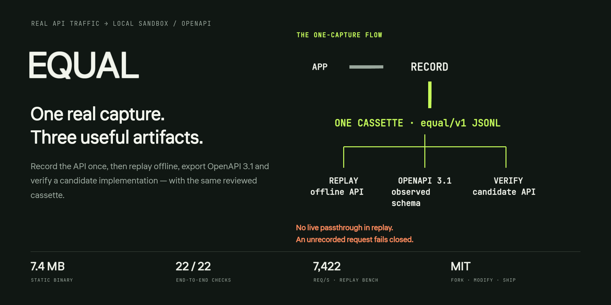
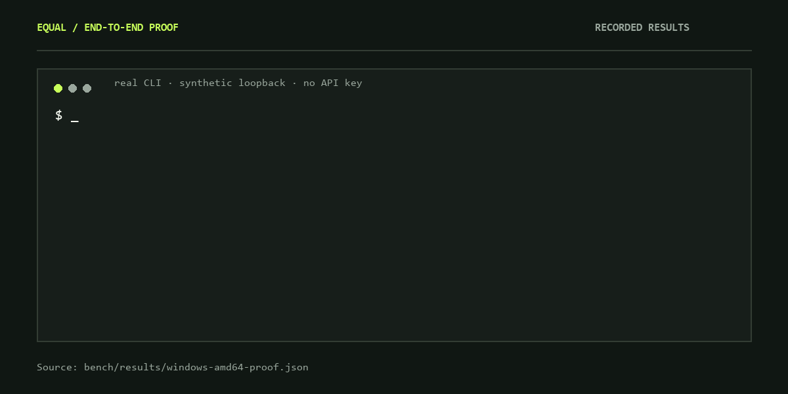
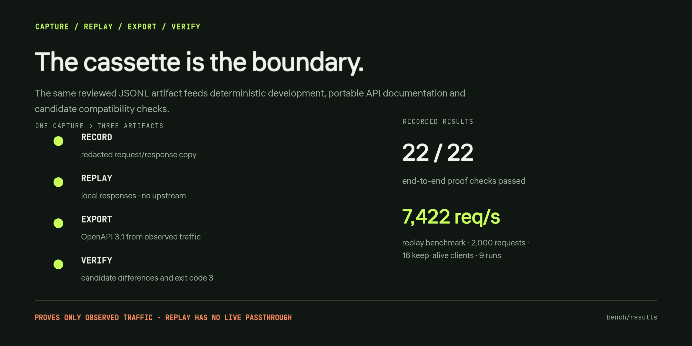

<div align="center">
  
  <p><strong>Превратите реальный API-трафик в локальную sandbox и OpenAPI.</strong></p>
  <p>Один статический бинарник 7,4 МБ · любой HTTP SDK · MIT</p>
  <p><a href="README.md">English</a> · <a href="#установка">Установка</a> · <a href="#старт-за-90-секунд">Старт за 90 секунд</a> · <a href="#проверка">Проверка</a> · <a href="BENCHMARKS.md">Измерения</a> · <a href="https://balanov.pro/equal/">Сайт</a></p>
</div>

Краткое русское введение. Полная документация по командам, формату cassette, красной маскировке, verify и ограничениям — в [английском README](README.md).

## Что делает EQUAL

EQUAL позволяет продолжать разработку, когда API недоступен, ограничен по rate limit, оплачивается за вызов или небезопасен для запуска в CI.

Направьте приложение на локальный recorder и один раз пройдите обычный сценарий. EQUAL превращает наблюдаемые запросы и ответы в три артефакта:

1. **Локальный API server**, который возвращает записанные ответы без обращения к провайдеру.
2. **Переносимую JSONL cassette**, которую можно просматривать, редактировать, передавать и версионировать в Git.
3. **Документ OpenAPI 3.1** для Postman, Prism, документации и генераторов SDK.

Приложению достаточно настраиваемого HTTP base URL. Нет language plugin, control plane, базы данных, аккаунта, телеметрии и каталога коннекторов.

<div align="center">
  
  <p><sub>Записанный proof: <a href="bench/results/windows-amd64-proof.json">22 / 22 проверки</a>.</sub></p>
</div>

## Установка

Unix:

```sh
curl -fsSL https://raw.githubusercontent.com/Balanov/equal/main/install.sh | sh
equal --version
```

`EQUAL_VERSION=0.2.0` фиксирует версию, `EQUAL_INSTALL_DIR` меняет `$HOME/.local/bin`.

Windows PowerShell:

```powershell
irm https://raw.githubusercontent.com/Balanov/equal/main/install.ps1 | iex
equal --version
```

`$env:EQUAL_VERSION = "0.2.0"` фиксирует версию, `$env:EQUAL_INSTALL_DIR` меняет каталог установки.

Также можно использовать Go 1.26+:

```sh
go install github.com/Balanov/equal/cmd/equal@latest
```

Или собрать checkout:

```sh
git clone https://github.com/Balanov/equal.git
cd equal
go build -trimpath -ldflags="-s -w" -o bin/equal ./cmd/equal
```

На Windows вывод — `bin/equal.exe`. Каждый релиз содержит SHA-256 checksums. Бинарники пока не code-signed.

## Старт за 90 секунд

### 1. Запишите реальный трафик приложения

```sh
equal record \
  --target https://api.example.com \
  --cassette account.jsonl
```

Recorder слушает `127.0.0.1:8080`. Укажите приложению base URL `http://127.0.0.1:8080` и выполните обычный сценарий. Например:

```sh
curl http://127.0.0.1:8080/v1/account \
  -H "Authorization: Bearer $TEST_TOKEN"
```

Остановите recorder через Ctrl+C и **проверьте cassette на чувствительные данные**:

```sh
equal inspect --cassette account.jsonl
```

### 2. Запустите локальную копию без провайдера

```sh
equal replay --cassette account.jsonl
```

Приложение работает с тем же локальным base URL. Записанные ответы возвращаются без сети. Незаписанный запрос явно возвращает 404 вместо незаметного выхода в live network.

### 3. Экспортируйте OpenAPI

```sh
equal export \
  --cassette account.jsonl \
  --out openapi.json \
  --title 'Account API'
```

Готовый `openapi.json` импортируется в существующие API-инструменты. См. синтетические [cassette](examples/cassette.jsonl) и сгенерированный [OpenAPI](examples/openapi.json).

## Проверка

<div align="center">
  
</div>

```sh
go build -o bin/equal.exe ./cmd/equal
python bench/proof.py ./bin/equal.exe
```

Proof управляет настоящим исполняемым файлом: записывает три взаимодействия через CLI, останавливает upstream, replay-ит offline, проверяет совместимую реализацию и намеренно несовместимую. В записанном прогоне прошло **22 / 22** проверок, включая redaction, binary fidelity, fail-closed miss, JSON report и exit code 3 при drift.

Replay benchmark: медиана **7 422 requests/s** на 2 000 уникальных GET, 16 keep-alive клиентов и 9 прогонах. Результат Hoverfly в той же среде — 3 624 requests/s. Это локальные измерения, а не универсальный рейтинг; методология и сырые образцы — в [BENCHMARKS.md](BENCHMARKS.md) и [bench/](bench/README.md).

## Границы

EQUAL — инструмент разработки и тестирования, не production proxy. Replay доказывает только наблюдаемый трафик. У replay нет upstream-опции и live passthrough. Красная маскировка — защита, а не гарантия приватности: просматривайте cassette перед передачей. Подробности — в [SECURITY.md](SECURITY.md), [docs/ARCHITECTURE.md](docs/ARCHITECTURE.md) и [docs/RESEARCH.md](docs/RESEARCH.md).

[MIT](LICENSE): форкайте, изменяйте и публикуйте свои версии.
